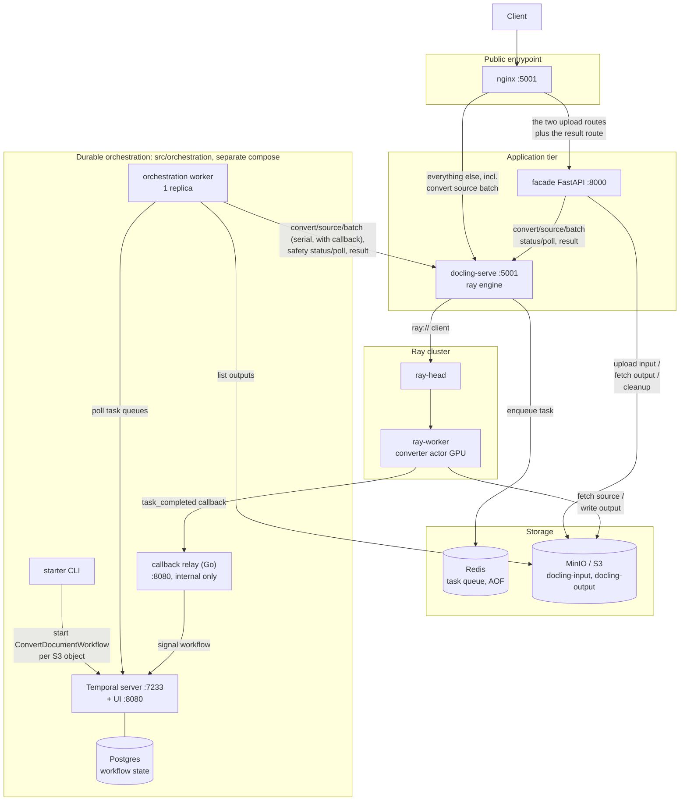
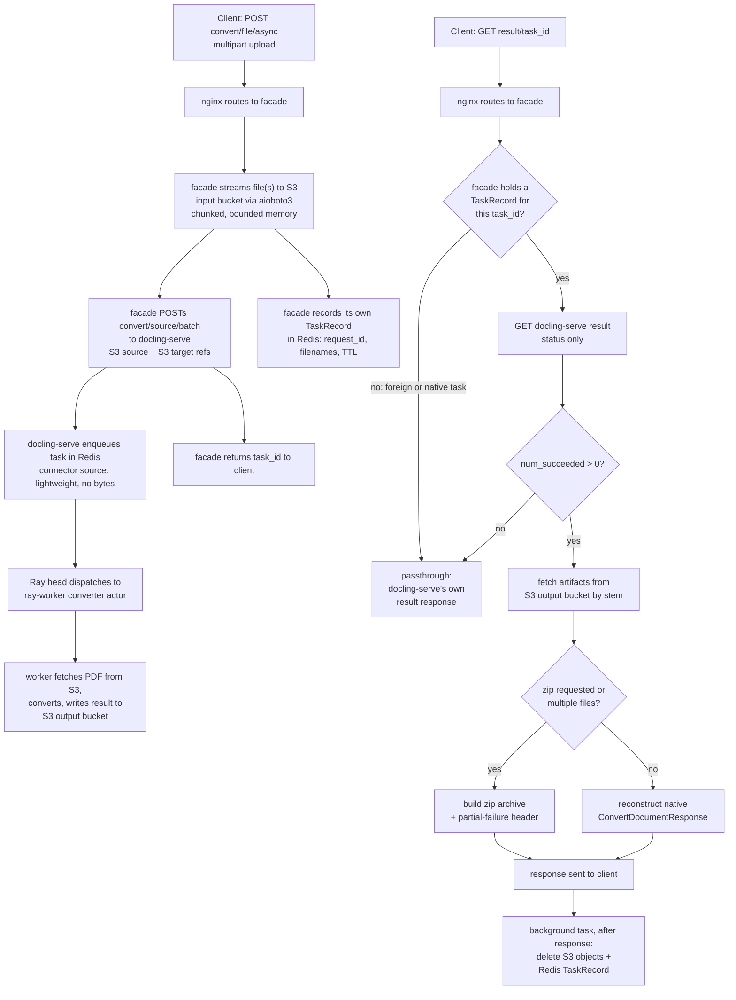
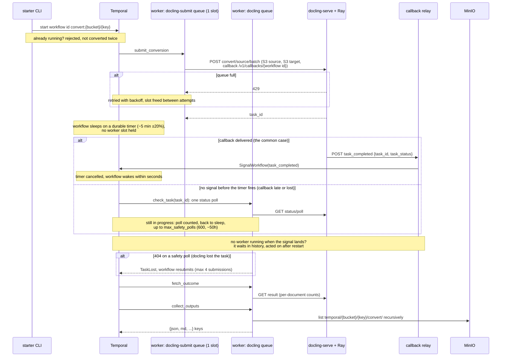

# Architecture

## Motivation

This project is a self-hosted, GPU-accelerated deployment of
[docling-serve](https://github.com/docling-project/docling-serve) behind
[Ray Serve](https://docs.ray.io/en/latest/serve/index.html), built around two
real problems found in docling-serve v1.29.0 / docling-jobkit 3.2.0's Ray
orchestrator while operating it. Neither is a configuration mistake on this
repo's side — both are traced to root cause in upstream code (see
[`upstream-issue-draft.md`](../upstream-issue-draft.md) for the full write-up
with reproductions).

### Bug 1 — every S3-source batch conversion fails under Ray

`SourceChunkConvertRequest.chunk` is typed `DocumentChunk[Any, Any]` — a
dynamically-parameterized Pydantic generic with no stable, importable
qualname. Ray has to serialize that value across the Serve-replica process
boundary (coordinator → converter actor) for every S3-source fan-out call,
and deserialization fails instantly:

```
ray.exceptions.RaySystemError: System error: 'type'
KeyError: 'type'  (inside pickle.loads on the receiving replica)
```

The task reports `task_status: success` at the top level, but every document
fails (`num_succeeded: 0`) and nothing reaches the target bucket — before the
converter ever runs. This isn't specific to `Any`; it reproduces with any
subscripted Pydantic generic crossing that boundary, so it would silently
resurface for any future connector (Azure Blob, GCS, ...) typed the same way.

**Fix**: re-type the field as the bare `DocumentChunk` — same runtime
validation (the class already has `arbitrary_types_allowed=True`), just
without the coercion into an unpicklable dynamic class. Verified end-to-end
against a live MinIO + Ray cluster: 5/5 documents failed before the patch, 5/5
succeeded after. This repo originally layered that one-line change onto the
official base image itself; it has since landed upstream as
[docling-jobkit#263](https://github.com/docling-project/docling-jobkit/pull/263)
(jobkit v3.8.1, first shipped in docling-serve v1.36.0), so the overlay was
dropped when the base moved to v1.36.0. The patched image's structure test
still asserts the base carries the fix, so a future base bump can't silently
regress it.

### Bug 2 — multipart uploads durably persist full document bytes (and connector credentials) into Redis

The orchestrator's task-admission path base64-encodes the *entire* uploaded
document into the `Task` object it constructs, then `RPUSH`es it onto a Redis
list backed by `--appendonly yes` (AOF). This is the fate of **every**
multipart upload (`/v1/convert/file`, `/v1/convert/file/async`) and every
inline source request — the sync endpoint isn't exempt either, it goes
through the identical `enqueue()` path before blocking on the poll. Separately,
the serialization helper used for this persistence does not redact
`SecretStr`/`SecretBytes` fields — it actively restores their plaintext value
first, so any connector source carrying credentials (S3 access/secret keys)
gets written to that same AOF-persisted log in cleartext.

Measured on a real 50MB PDF: **~63.6MB written to Redis's AOF** through the
raw `/v1/convert/file` endpoint. AOF only shrinks on a Redis-triggered
rewrite (`BGREWRITEAOF`) — not when the task completes or is dequeued — so
Redis's disk footprint tracks *total historical document volume*, not queue
depth.

The one route that avoids this is `/v1/convert/source/batch` used with a
genuine connector source (e.g. an S3 reference) — connector sources are
validated as lightweight config and never hit the base64-embedding branch.
That's not a config flag docling-serve exposes on the endpoints clients
actually want to use, though; it's a structural side effect of a different,
less-obvious endpoint. There's no proposed upstream fix yet (it's a real
architectural change, not a one-liner), so this repo works around it at the
client boundary instead: **the facade**.

### The facade: a claim-check shim, not a permanent architecture

The facade is a small FastAPI service that intercepts exactly the two unsafe
routes (`/v1/convert/file`, `/v1/convert/file/async`) and the result endpoint
needed to serve them, and re-implements them on top of the *safe* path:
upload to S3 itself, submit via `/v1/convert/source/batch`, reconstruct
docling-serve's native response shape from the S3 output afterward. Same
measured 50MB PDF: **~7.7KB written to Redis's AOF** through the facade —
just a `TaskRecord` reference, no document bytes. Everything else (including
the already-safe `/v1/convert/source/batch`) passes straight through
untouched. If/when docling-serve fixes Bug 2 upstream, the facade's job here
shrinks to nothing and it can be removed without touching any other part of
the stack — it's deliberately scoped as a workaround for a specific gap, not
a general-purpose proxy layer.

## Architecture



### Components

- **nginx** — the one public entrypoint (port `5001`). Routes exactly three
  paths to the facade (`/v1/convert/file`, `/v1/convert/file/async`,
  `/v1/result/*`); everything else goes straight to `docling-serve`
  unmodified, including `/v1/convert/source/batch`, which is already
  S3-native and byte-free. Config: `src/nginx/nginx.conf`.
- **facade** — see [Motivation](#motivation) above. FastAPI app
  (`src/facade/{main,service,dependencies,utils,schemas}.py`). Streams
  uploads to S3 via `aioboto3`'s async multipart `upload_fileobj` instead of
  buffering them in memory, so peak RAM per upload is bounded by the client's
  part size, not file size. Deletes its S3 objects and its own Redis record
  once a result has been delivered — that storage is single-use.
- **docling-serve** — runs with `DOCLING_SERVE_ENG_KIND=ray`, connecting to
  the Ray cluster over `ray://ray-head:10001`. Owns its own task queue in
  Redis (a different concern than the facade's small `TaskRecord` keys) and
  its own converter dispatch logic.
- **Ray head / ray-worker** — a single-node head + worker pair. The worker
  runs the GPU converter actor, pinned to exactly one warm replica (a 10GB
  VRAM budget), with PDF page-slice fan-out enabled so a single large
  document can still parallelize within that one replica's concurrency limit.
- **Redis** — `--appendonly yes` (AOF), shared by docling-serve's task queue
  and the facade's own lightweight `TaskRecord`s (a separate key prefix,
  `facade:task:*`, `SET ... EX <ttl>`, not `RPUSH`).
- **MinIO / S3** — two buckets, `docling-input` and `docling-output`. Real
  deployments would point `FACADE_S3_*` / the Ray converter's AWS config at
  any S3-compatible endpoint; MinIO here is purely the local/dev stand-in
  (Chainguard's from-source image — MinIO's own images are no longer
  publicly pullable).
- **Temporal orchestration** (`src/orchestration/`, its own
  `docker-compose.yml`) — a second, independent entrypoint into the same
  backend, for documents *already in S3*. It talks to raw docling-serve
  directly, not through nginx/the facade: its inputs are S3 coordinates,
  which `/v1/convert/source/batch` already handles without any document
  bytes in Redis, so the claim-check step has nothing to do. Temporal server
  (Postgres-backed) + UI + one worker process + the callback relay; the
  worker and the relay join the main stack's network by name. See
  [the Temporal path](#request-flow-the-temporal-path).
- **Callback relay** (`src/callback_relay/`, Go) — receives docling-serve's
  task-completion callbacks on `/v1/callbacks/{workflow id}` and turns each
  into a `task_completed` signal for that workflow. Stateless: the URL names
  the workflow and the payload names the task, so it keeps no lookup table and
  can run several replicas. Checks a shared token on every callback. Built
  with rules_go/gazelle and rules_oci onto `distroless/static` (a pure-Go
  static binary, no shell).

## Request flow: the claim-check path

Tracing `POST /v1/convert/file/async` through to `GET /v1/result/{task_id}`
— the two routes the facade actually reworks (`src/facade/service.py`):



Two details worth calling out:

- **Cleanup runs strictly after the response is sent.** It's a FastAPI
  `BackgroundTasks` entry, not inline — delivery is never delayed or put at
  risk by the cleanup step, and cleanup is best-effort (logs and swallows
  failures rather than raising, since there's no request left to surface an
  error to by the time it runs).
- **The synchronous `/v1/convert/file` endpoint is the same flow plus a
  poll.** `service.submit_file_upload` is identical; `main.convert_file_sync`
  just adds `wait_for_completion` (mirroring docling-serve's own
  `_wait_task_complete`) before falling into the same result-reconstruction
  path as the async+poll case.

## Request flow: the Temporal path

One `ConvertDocumentWorkflow` per S3 object, started by the CLI
(`bazel run //src/orchestration:start -- convert --prefix incoming/`):



Properties worth knowing:

- **Serial admission.** Submits run on their own task queue, served with
  `max_concurrent_activities=1`, so docling-serve sees one admission at a
  time. Its per-tenant queue counter isn't updated atomically, so concurrent
  submits overshoot `MAX_QUEUED_TASKS`; serial submits keep it exact
  (measured: a 20-document burst peaked at exactly 8 queued + 2 active, with
  every 429 absorbed as a retried submit). **Run exactly one worker
  replica**: the limit is per process.
- **Sleep until called back, poll as a safety net.** Waiting is a durable
  timer, not a running activity: a document that spends hours queued and
  converting holds no worker slot. docling-serve's callback reaches the relay,
  which signals the workflow; jobkit sends it from a background thread with 3
  attempts over about 3 s and stores nothing, so the workflow polls once each
  time its jittered timer runs out without a signal. A poll that finds the
  task in progress counts against `max_safety_polls`; one docling-serve can't
  answer (3 quick attempts) counts too, and the workflow sleeps again, still
  wakeable by a callback.
- **Resume, don't resubmit.** The timer and any signal live in the
  workflow's history on the server, so a worker restart resumes the wait on
  the same docling task. Verified by SIGKILLing the worker right after
  submit, letting docling call back while no worker runs, and restarting it
  (`tests/temporal/`).
- **At-least-once submits.** docling-serve has no idempotency key: a crash
  between the POST landing and the activity completing means one duplicate
  conversion into the same per-document prefix (costs GPU time, corrupts
  nothing). TaskLost resubmits likewise leave the original conversion running
  on Ray until it finishes.
- **`success` isn't the verdict.** docling reports `task_status=success`
  even when every document in the task failed -- a PDF it can't read comes
  back as a successful task with `num_failed=1` -- so the workflow checks
  the result's per-document counts and that a `json` output exists. A
  *task* fails outright when docling can't run it at all (its S3 source is
  gone, say), reported by docling's dispatcher rather than the Ray
  deployment; the workflow fails with docling's message from that callback.
- **Always emits DoclingDocument JSON**, whatever formats are requested —
  it's what a chained chunking step re-ingests (`from_formats=["json_docling"]`)
  without re-running the conversion pipeline.
- **No secrets in workflow history.** S3 credentials, endpoints and the
  callback token come from the worker's `ORCH_*` env; workflow inputs are
  only bucket, key, conversion options and the safety-poll knobs. The token
  does reach docling-serve's Redis task records (it's sent with each
  submit), which is why the relay is never published to the host.
- **Activity timeouts are worker config too** (`ORCH_*_START_TO_CLOSE_SECONDS`),
  read when each activity is scheduled. Temporal doesn't compare activity
  timeouts on replay, so a worker restarted with new values also applies them
  to workflows already in flight; a replay test pins that.

## Testing

```bash
bazel test //...              # fast, hermetic — no Docker needed
bazel test //:test.docker     # Docker-dependent — needs a real daemon
```

- **`bazel test //...`** — container structure tests (build each OCI image,
  assert on its filesystem/entrypoint via `container_structure_test`'s tar
  driver, no daemon needed), the Python and Go unit suites,
  `//tools/format:format_test` (formatting check, see below) and
  `//:gazelle_test` (Go BUILD files match the sources). All hermetic, runs
  on every commit locally and in CI.
- **`bazel test //:test.docker`** — the patch-import check (proves the Ray
  pickling fix is actually the code that gets *imported* at runtime, not
  just present in the tarball — a real, distinct failure mode from a plain
  structure test), plus testcontainers-driven integration and e2e layers
  (real `docker compose` stacks, a real Docker socket). Tagged `manual` in
  Bazel — excluded from a plain `//...` sweep, named explicitly here or via
  CI. GitHub-hosted runners have no GPU, so CI runs this suite against a
  CPU-only image variant instead (`DOCLING_COMPOSE_CPU_OVERLAY=1`, see
  `tests/ci/`); locally, against real GPU hardware, it uses the unmodified
  stack.
- **Functional vs. structural**: each of `src/facade/`, `src/nginx/`, and the
  Ray patch splits its tests into `tests/functional/` (real test code) and
  `tests/structural/` (`container_structure_test` YAML configs).
- **Integration vs. e2e**: `tests/integration/` proves the facade's
  claim-check logic against a genuinely running `docling-serve`, with nginx
  deliberately excluded — that's `tests/e2e/`'s job, which additionally
  proves the routing itself (hitting everything through nginx, the only path
  a real client would use).
- **Orchestration**: `src/orchestration/tests/functional/` covers activity
  failure classification (mocked docling-serve), request bodies checked
  against docling-serve's own request models (`docling-slim`, test-only), and
  workflow logic in Temporal's time-skipping test server — pinned by sha256
  in `MODULE.bazel`, never downloaded at test time. The worker process's own
  setup (`worker.build_workers`) runs there too, with the real activities
  against a fake docling-serve: submits stay serial across a burst of
  workflows, stopping the worker lets an in-flight submit finish, and a
  document in flight can't be dispatched twice. Callbacks are sent as the
  relay's raw JSON, pinning the signal contract from the Python side;
  `src/callback_relay/relay` pins it from the Go side. `tests/temporal/` runs
  both real stacks (backend + Temporal + relay): each way a workflow is woken
  (the callback, the safety poll with the relay down, a callback landing
  while no worker runs); each way docling reports trouble (an unreadable
  document, a failed task, a lost task, an expired result); a Temporal
  server restart and a relay with the wrong token; and docling-serve's own
  429 for a full queue, the patched image's reason to exist.
- **Formatting and linting** — ruff (Python), buildifier (Starlark), yamlfmt
  (YAML), gofumpt (Go), and a ruff lint aspect, mirroring Artemis's own
  convention. Go has no separate lint step: nogo runs `go vet` inside every
  Go compile, so a finding fails the build.

  ```bash
  bazel run //:format                                   # auto-fix in place
  bazel test //tools/format:format_test                  # check only
  bazel build --aspects=//tools/lint:linters.bzl%ruff \
      --output_groups=rules_lint_human \
      --@aspect_rules_lint//lint:fail_on_violation //...  # ruff lint, repo-wide
  ```

## Deployment

- **Bazel/rules_oci** — reproducible builds for all five custom images
  (patched `docling-serve`, `facade`, `nginx`, the orchestration worker, the
  callback relay), each pinned to its upstream base by digest in
  `MODULE.bazel`. `bazel run //:load.all` builds and loads all five into the
  local Docker daemon in one command. The relay follows rules_oci's Go guide:
  a gazelle-generated `go_binary` (Go toolchain and modules from the root
  `go.mod`, fetched hermetically) in a `tar` layer on `distroless/static`,
  built through a linux/amd64 platform transition. The orchestration worker
  follows rules_oci's Python guide, as Artemis does: an `aspect_rules_py`
  `py_binary`, split by `py_image_layer` into interpreter, site-packages and
  app layers (a code change re-uploads under 1 MB), on plain `ubuntu:24.04`.
  The only Python in the image is rules_python's hermetic interpreter from
  the runfiles. It runs as the non-root `ubuntu` user, who owns the runfiles
  because the launcher creates the binary's venv there on every start. Not
  distroless: the launcher is a bash script.
- **Temporal stack** — `docker compose -f src/orchestration/docker-compose.yml up -d`,
  after the main stack (the worker and the relay join its network). Official
  `temporalio/{server,admin-tools,ui}` + `postgres` images pinned by digest;
  schema setup and namespace creation are idempotent one-shots. Host ports
  bind to localhost and are overridable (`TEMPORAL_HOST_PORT`,
  `TEMPORAL_UI_HOST_PORT`) for machines already running another Temporal.
- **`Containerfile` fallbacks** — the patched docling-serve and the facade
  also have a plain `docker build`-able `Containerfile` next to their own
  `BUILD.bazel` (`src/patches/docling_serve/Containerfile`,
  `src/facade/Containerfile`), for anyone iterating without Bazel set up.
  The orchestration worker and the callback relay are built by Bazel only.
- **`docker compose up`** — brings up the full stack against the locally
  loaded/built images: MinIO, Redis, ray-head/ray-worker, `docling-serve`,
  `facade`, `nginx`. Only `nginx` (`5001`) and MinIO (`9000`/`9001`, for
  direct S3-source-batch uploads bypassing the facade — see
  `scripts/send_pdf.py`) publish host ports; everything else is reachable
  only over the internal Compose network.
- **CI/CD** (`.github/workflows/`):
  - `ci.yml` — on every PR and push to `main`: `lint` (the ruff aspect
    above) runs first and gates `test` (`bazel test //...`) and
    `test-docker` (the Docker-dependent suite, CPU-only), which then run in
    parallel with each other. On push to `main`, once all three pass, also
    pushes the five production images to GHCR as `:latest`
    (`ghcr.io/k-sparrow/docling-serve-ray-{patched,facade,nginx,orchestration,callback-relay}`). The
    CI-only CPU-patched image variant is never pushed — it's test
    infrastructure, not a deployable artifact.
  - `nightly-docker-tests.yml` — the same Docker-dependent suite again, on an
    every-other-day cron plus manual dispatch, as an environment-drift canary
    independent of code changes (intentionally redundant with `ci.yml`'s
    `test-docker` job).
- **Requirements** — Docker Compose, an NVIDIA GPU with drivers + the NVIDIA
  Container Toolkit for the real stack; Bazel (via `bazelisk`) for the
  reproducible builds (required for the orchestration worker and the relay,
  optional for the images with `Containerfile` fallbacks); Python 3 with `requirements.in`'s packages to run
  `scripts/send_pdf.py`.
